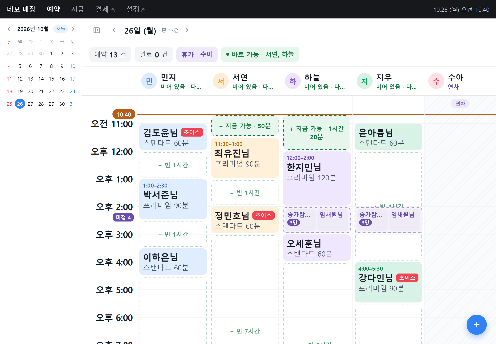
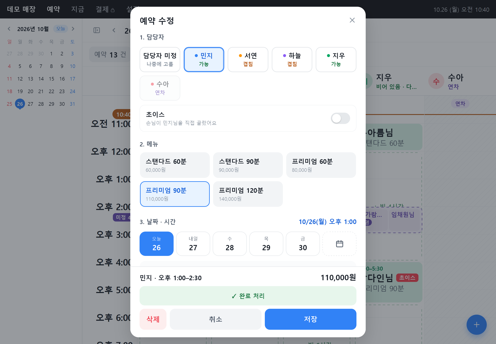

# 타임보드 (Timeboard)
> 직원 여러 명이 시간 단위로 손님을 받는 소규모 매장을 위한 예약 보드. 누가 언제 비어 있는지 카운터의 아이패드 한 화면에서 바로 보고, 탭 몇 번으로 예약을 잡는다.



- 서비스: [바로가기](https://timeboard-five.vercel.app)
- 개발 기간: 2026.10 ~ (운영하면서 계속 개선 중)
- 개발 인원: 개인
- 담당 역할: 기획, 화면 설계, 프론트엔드, DB 설계(Supabase), 배포까지 전부

## 1. 프로젝트 소개
- **배경**: 직원 여러 명이 시간 단위로 손님을 받는 매장에서는 예약 하나를 잡을 때도 직원마다 일정을 따로 확인해야 한다. 이 과정을 한 화면으로 줄여 보려고 시작했고, 실제 매장에서 쓰면서 나온 요청을 반영해 계속 고쳐 나가고 있다.
- **해결하려는 문제**
  - 전화로 예약이 들어왔을 때 "몇 시에 누가 비어 있는지"를 바로 답하기 어렵다.
  - 손님이 직원을 지명하는 경우(초이스)와 아무나 괜찮은 경우가 섞여 있어서, 예약을 받는 시점에 담당자를 못 정할 때가 있다.
  - 직원 휴무·연차, 직원마다 다른 근무 시간을 머릿속으로 계산해야 한다.
  - 직원도 같이 보는 기기라 매출이나 설정 화면은 사장님만 열 수 있어야 한다.

## 2. 주요 기능
- **예약 보드**: 직원별 칸에 예약이 시간 블록으로 보인다. 빈 시간은 "지금 가능 · 50분"처럼 표시되고, 누르면 그 직원·그 시각으로 예약 창이 열린다.
- **예약 등록**: 담당자 → 메뉴 → 날짜·시간 → 손님 순서로 한 화면에서 입력한다. 메뉴를 고르면 소요 시간과 가격이 자동으로 들어가고, 이미 예약이 있거나 휴가인 직원은 "겹침", "연차"로 표시된다.
- **담당자 미정 예약**: 담당자를 비워 둔 채 예약을 받을 수 있다. 그 시간에 손님을 받을 수 있는 직원 칸에 흐린 카드가 뜨고, 카드를 누르면 그 직원에게 바로 배정된다(되돌리기 가능). 일행이 여러 명이면 인원 수만큼 한 번에 등록한다.
- **초이스 표시**: 손님이 직원을 직접 고른 예약은 이름 옆에 빨간 "초이스" 표시가 붙는다.
- **직원 관리**: 보드에서 직원 이름을 길게 눌러 끌면 순서가 바뀌고, 짧게 누르면 그날 휴무를 지정할 수 있다. 쉬는 직원은 오른쪽 끝으로 빠진다. 근무 요일·시간, 정산 비율, 휴가는 설정에서 관리한다.
- **지금 탭**: 지금 손님을 받고 있는 직원, 곧 시작하는 예약, 시간이 지났는데 완료 처리가 안 된 예약을 모아서 보여 준다.
- **결제·설정 잠금**: 정산과 설정 화면은 사장님 PIN을 넣어야 열리고, 5분 동안 조작이 없으면 다시 잠긴다.
- **매장별 계정**: 매장마다 가입해서 따로 쓰고, 다른 매장의 데이터는 볼 수 없다.
- **큰 글씨 / 화면 배율**: 글자 크기와 보드 밀도를 설정에서 조절할 수 있다. 실제 사용자가 글씨를 더 키워 달라고 해서 기본 크기도 크게 잡았다.



## 3. 기술 스택
| 구분 | 기술 |
|---|---|
| Frontend | React 19, Vite, CSS (UI 라이브러리 없이 직접 작성) |
| Backend | 별도 서버 없음. Supabase Auth, PostgreSQL 함수(RPC) |
| Database | Supabase PostgreSQL, Row Level Security |
| Infra / 배포 | Vercel (main 브랜치 자동 배포), PWA (manifest, Service Worker) |

### 주요 기술 선택 이유
- **Supabase**: 처음에는 Spring Boot로 API 서버를 만들었다. 그런데 무료 호스팅에 서버를 올리면 한동안 요청이 없을 때 서버가 잠들어서 첫 응답이 수십 초씩 늦어진다. 매장에서 아침에 앱을 열었을 때 기다리게 할 수는 없어서, 서버 없이 프론트에서 DB에 바로 붙는 구조로 바꿨다. 대신 권한 검사는 DB의 RLS 정책과 함수로 처리했다.
- **React + Vite**: 화면 하나에서 상태가 자주 바뀌는 앱이라 React를 썼고, 빌드가 빠르고 설정이 거의 필요 없는 Vite를 골랐다.
- **UI 라이브러리를 쓰지 않은 이유**: 아이패드 터치(길게 누르기, 끌기, 큰 글씨 배율)를 세세하게 맞춰야 했는데, 기성 컴포넌트를 고치는 것보다 필요한 것만 직접 만드는 쪽이 빨랐다.
- **PWA**: 카운터 아이패드 홈 화면에 앱처럼 설치해서 주소창 없이 전체 화면으로 쓰려고 적용했다.

## 4. 구조
프론트엔드가 supabase-js로 DB에 직접 접근하고, 데이터 접근은 전부 `api.js` 한 파일을 거친다. 매장 구분과 권한은 DB 쪽(RLS, 함수)에서 처리한다.

```
React (Vercel)  ──supabase-js──▶  Supabase
  └ api.js                          ├ Auth (이메일 로그인)
                                    ├ PostgreSQL + RLS (매장별 데이터 격리)
                                    └ 함수: 매장 만들기, PIN 확인·재설정
```

```
frontend/src/
  Root.jsx              로그인 → 매장 확인 → App
  App.jsx               화면 상태와 조립 (탭, PIN 잠금)
  api.js                데이터 접근 (Supabase)
  lib/schedule.js       빈 시간, 직원 현재 상태, 배정 가능 여부 계산
  lib/autoUpdate.js     새 배포 감지 후 자동 새로고침
  components/
    Board.jsx           예약 보드
    ReservationModal.jsx 예약 등록·수정 창
    NowPage.jsx         지금 탭
    PayrollPage.jsx     정산
    SettingsPage.jsx    설정 (직원, 매장 운영, 화면)
supabase/               테이블, RLS 정책, 함수 SQL
backend/                초기 Spring Boot API (현재 배포에는 사용하지 않음)
```

## 5. 핵심 구현 및 문제 해결
### 서버 없이 매장별 데이터 분리하기
- **상황**: 여러 매장이 가입해서 쓰는데 프론트가 DB에 직접 접근한다. 프론트 코드에서 매장 id로 걸러 내는 것만으로는 요청을 조작하면 다른 매장 데이터가 보일 수 있다.
- **해결**: 모든 테이블에 `shop_id`를 두고 기본값을 로그인한 계정의 매장(`my_shop_id()`)으로 잡았다. RLS 정책으로 자기 매장 행만 읽고 쓰게 했고, 예약·휴가가 가리키는 직원은 `(staff_id, shop_id)` 복합 외래키로 묶어서 다른 매장 직원을 넣을 수 없게 했다. 사장님 PIN은 bcrypt 해시로만 저장하고 DB 함수에서 확인하며, 5번 틀리면 5분 동안 잠긴다.
- **결과**: 프론트 코드와 상관없이 DB 단에서 매장 간 데이터가 섞이지 않는다. 화면에서는 PIN 해시를 읽을 수 없다.

### 담당자 미정 예약을 탭 한 번으로 배정하기
- **상황**: 전날 지명을 많이 받은 직원은 다음 날 순번이 뒤로 밀리는 등, 예약을 받을 때 담당자를 정하기 애매한 경우가 많았다. 일단 시간만 잡아 두고 손님이 올 때쯤 정하고 싶다는 요청이 있었다.
- **해결**: 예약의 담당자 컬럼을 비워 둘 수 있게 바꾸고, 그 예약을 맡을 수 있는 직원을 계산하는 함수를 만들었다(근무 요일, 근무 시간, 휴가, 다른 예약과 겹치는지 확인). 보드에서는 가능한 직원 칸에만 흐린 카드를 띄워서 누르면 바로 배정되게 했다. 같은 시간에 미정 예약이 여러 팀이면 카드를 나란히 쪼개지 않고 한 카드 안에 작은 카드로 묶어서 이름이 잘리지 않게 했다.
- **결과**: 예약 창을 다시 열지 않고 보드에서 탭 한 번으로 배정한다. 잘못 눌렀을 때는 바로 뜨는 "되돌리기"로 취소할 수 있다.

### 아이패드 Safari에서 화면 배율과 좌표가 어긋나던 문제
- **상황**: 글씨를 키워 달라는 요청 때문에 CSS `zoom`으로 화면 배율 기능을 넣었더니, 아이패드 Safari에서 보드 칸을 눌렀을 때 엉뚱한 시간이 잡히고, 직원 순서를 끌어서 바꿀 때 놓는 위치가 어긋났다. 핀치 확대를 한 번 하고 나면 화면 아래에 빈 공간이 생기는 문제도 있었다.
- **해결**: WebKit에서는 `getBoundingClientRect()`가 배율이 적용된 단위로, 터치 좌표는 화면 픽셀로 나와서 서로 단위가 달랐다. 칸 클릭은 픽셀 대신 "칸 안에서의 비율"로 시간을 계산하고, 끌기는 두 값의 환산 계수를 구해서 맞췄다. 화면 높이는 `visualViewport`로 직접 재서 맞추고, 앱 안에서는 핀치 확대를 막았다. 아주 긴 칸의 점선 테두리가 iOS에서 중간까지만 그려지는 문제도 있어서, 점선은 `repeating-linear-gradient`로 그렸다.
- **결과**: 배율을 바꿔도 누른 위치의 시간이 정확히 잡히고, 아이패드와 아이폰에서 점선과 화면 높이가 정상으로 보인다.

### 켜 둔 아이패드가 옛 버전에 머무는 문제
- **상황**: 매장 아이패드는 앱을 하루 종일 켜 두고 홈 화면 앱으로 쓰기 때문에, 새로 배포해도 직접 새로고침하기 전까지는 옛 화면이 계속 떠 있었다.
- **해결**: 화면으로 돌아올 때와 켜 둔 동안 5분마다 `index.html`을 다시 받아서, 빌드 파일 이름(해시)이 지금 화면과 다르면 새로고침하게 했다. 예약 창이 열려 있거나 입력 중일 때는 새로고침을 미뤘다가 끝나면 한다.
- **결과**: 배포 후 별도 안내 없이 매장 기기에 새 버전이 반영되고, 입력하던 내용이 날아가지 않는다.
